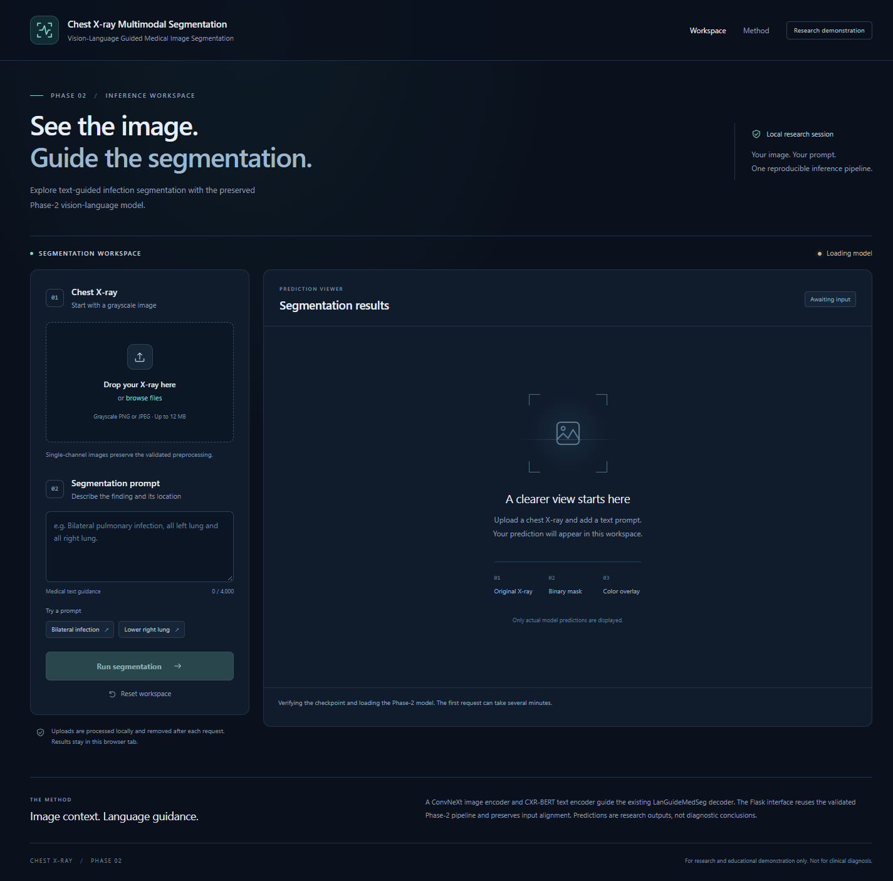

# Chest X-ray Multimodal Segmentation

Text-guided segmentation of infected areas in chest X-rays, based on LanGuideMedSeg. An image encoder and a medical language encoder combine image features with the matching annotation prompt. The new Flask application and notebook 07 reuse the validated Phase-2 inference pipeline. Original Streamlit code, research notebooks, diagnostic experiments, and results are preserved.

**Research prototype.** The recorded Phase-2 scores are validation results used for checkpoint selection. They are not independent test results or evidence of clinical suitability. A public clone needs separately restored datasets, annotations, checkpoints, and pretrained resources; these are excluded from Git.

## Run the Flask application

After restoring the trusted resources in [CHECKPOINTS.md](docs/CHECKPOINTS.md), use Windows PowerShell:

```powershell
Set-Location path\to\x-ray
py -3.10 -m venv .venv  # Once, on a new checkout; keep an existing working environment.
.\.venv\Scripts\Activate.ps1
python -m pip install -r requirements.txt
python run.py
```

Open **http://127.0.0.1:5000**. Upload a **single-channel grayscale PNG/JPEG** and enter a nonempty medical/location prompt. The first request verifies and loads the selected checkpoint and can take several minutes on a small machine. Subsequent requests reuse the model. The interface shows accurate model readiness, the original image, binary mask, and unchanged red overlay, plus comparison/opacity controls, fullscreen, and PNG downloads. Threshold and preprocessing come from the research configuration; browser display controls do not change predictions.

No Dice, IoU, accuracy, or clinical confidence is invented for uploads without ground truth. RGB images are rejected rather than silently changing the Phase-2 preprocessing. Uploaded bytes are processed using temporary generated paths and removed after each request. Results stay in the tab unless downloaded.

The displayed allowance is **12 MiB per image** by default (`WEB_MAX_UPLOAD_MB`). Flask and Waitress permit an additional 64 KiB for multipart headers and the bounded prompt; the API separately enforces the exact image-byte limit. Selecting an invalid replacement clears the previous image, prediction, and download links before validation.



This screenshot was captured from the running application; it contains no medical image. Actual prediction screenshots remain local pending redistribution review. See [Flask application documentation](docs/FLASK_APPLICATION.md) for the API, CPU/CUDA selection, upload limits, restoration, tests, and deployment limitations. The original Streamlit application remains at `app.py`; it has not been removed or converted in place.

## Method and architecture

```text
Chest X-ray -> ConvNeXt-Tiny -> multi-scale visual features --+
                                                           +-> GuideDecoder -> sigmoid infection map
Text prompt -> CXR-BERT -> token features ------------------+
```

The decoder uses visual attention and text-guided cross-attention, followed by upsampling to a one-channel probability map. The text backbone is frozen. Images use the existing MONAI preprocessing at 224 x 224; prompts are tokenized to 24 tokens. Display rendering converts MONAI/PIL axis conventions explicitly and resizes probabilities before native-resolution display thresholding. Reported metrics below use the 224 x 224 model grid.

The Phase-2 pilot continued from the original epoch-18 checkpoint for two epochs on 5,722 training images and 1,423 validation images. Its protocol uses FP32, batch size 1, gradient accumulation 8, no augmentation, frozen decoder BatchNorm running statistics with trainable affine parameters, and a frozen text backbone in evaluation mode. The recorded loss is equal-weight BCEWithLogits and sigmoid soft Dice. The selected epoch maximizes full-validation macro Dice. See [the preserved protocol](experiments/phase2_pilot/PROTOCOL.md) and [configuration](experiments/phase2_pilot/config.json) for learning rates, guards, and checkpoint semantics.

## Structure

```text
notebooks/       seven local research notebooks, ignored pending publication review
src/             shared data, model, training, and inference implementations
webapp/          Flask factory, routes, Phase-2 service, templates and static assets
run.py           local Flask/Waitress application entry point
scripts/         training/evaluation/inference, annotation preparation, verification
experiments/     experiment programs, configurations, protocols; raw records local
results/         aggregate results without patient-level records or medical images
docs/            dataset, checkpoint, reproducibility, and cleanup documentation
app.py           hash-verified original-checkpoint Streamlit application
outputs/         ignored local outputs, verification runs, preservation inventory
```

Local `Project/`, `_qata_compatible/`, `pretrained/`, `text_annotation/`, `archive/`, and `reference_papers/` are retained on disk and excluded from the proposed Git payload. `presentation/` is also excluded if restored; that root folder was absent in the current cleanup inventory. Existing paths have been preserved to avoid breaking experiment lineage and model resolution.

## Installation

The observed working environment uses Python 3.10.20, PyTorch 2.6.0+cu124, MONAI 1.4.0, Transformers 4.38.2, and NumPy 1.26.4. See [reproducibility notes](docs/REPRODUCIBILITY.md) for exact observed package versions and verification limits. Dependency ranges are not a complete environment lock. Choose the appropriate PyTorch build before installing the selected group.

| Requirements file | Workflow |
| --- | --- |
| `requirements-core.txt` | Shared scientific inference libraries |
| `requirements.txt` | Flask runtime and Waitress, including core |
| `requirements-research.txt` | Training, evaluation exports, annotations and plotting |
| `requirements-notebook.txt` | Research dependencies plus Jupyter execution and widgets |
| `requirements-test.txt` | Flask/shared research unit tests and pytest |
| `requirements-web-test.txt` | Unit tests plus HTTP/browser validation clients |
| `requirements-legacy.txt` | Optional retained Streamlit app, including its Matplotlib import |
| `requirements-local-cuda.txt` | Existing CUDA 12.4 recipe plus all workflow groups |

`requirements.txt` now installs the Flask runtime; the older combined environment remains available through `requirements-local-cuda.txt`. For a portable combined setup install the notebook, web-test, and legacy files together. No installed packages are removed by this separation.

Use `python -m pip install -c constraints-observed.txt -r requirements.txt` to constrain the Flask setup to observed direct-package versions. The snapshot records the tested CUDA build but leaves platform/index selection explicit; it does not lock all transitive dependencies or certify a fresh install. Apply the same constraints to other groups as needed.

From the repository root, create and select a project `.venv`:

```powershell
py -3.10 -m venv .venv
.\.venv\Scripts\Activate.ps1
python -m pip install -r requirements-notebook.txt
```

Choose a PyTorch build appropriate to your platform before installing the rest. For the Windows CUDA 12.4 environment used here, the existing recipe is:

```powershell
python -m pip install -r requirements-local-cuda.txt
```

On POSIX systems, use `python3.10 -m venv .venv` and `source .venv/bin/activate`. These are setup instructions; this cleanup did not install dependencies or verify a fresh-environment installation. Open notebooks in your Jupyter frontend or VS Code and select this `.venv`. Notebook 07 explicitly checks the interpreter path. If your frontend needs a registered kernel, run `python -m ipykernel install --user --name xray-e-drive --display-name "Chest X-ray (.venv)"` from that environment. The isolated verifier does not require this user-level registration.

## Restore the inputs first

1. Obtain QaTa-COV19-v2 images, masks, and text workbooks through an authorized source; follow [dataset instructions](docs/DATASET.md).
2. Restore the original or Phase-2 checkpoint bundle appropriate to the workflow; follow [checkpoint instructions](docs/CHECKPOINTS.md).
3. Restore complete ConvNeXt and CXR-BERT resources before the offline Phase-2 notebook runs. Existing home-directory Hugging Face caches are external dependencies.

No public download location for the trained checkpoints or private runtime bundle has been approved. Exact reproduction from a Git-only clone is therefore not yet available. Do not substitute a similarly named checkpoint or regenerate provenance records to bypass hash checks.

## Notebooks

| Notebook | Role |
| --- | --- |
| [01](notebooks/01_dataset_setup_and_eda.ipynb) | Dataset preparation and exploratory analysis |
| [02](notebooks/02_multimodal_preprocessing.ipynb) | Image, mask, and text preprocessing |
| [03](notebooks/03_model_architecture.ipynb) | Architecture and component inspection |
| [04](notebooks/04_training_pipeline.ipynb) | Original training and diagnostic evidence |
| [05](notebooks/05_evaluation_and_results.ipynb) | Original held-out evaluation |
| [06](notebooks/06_inference_and_visualization.ipynb) | Original-checkpoint inference and visualization |
| [07](notebooks/07_phase2_live_inference.ipynb) | Selected Phase-2 checkpoint, live prompt controls, verified validation evidence |

All seven notebooks and the earlier preservation copies remain local. The Phase-1 review found notebooks 01–06 byte-identical to the prior inventory. Notebook 07 initially differed in kernel metadata; a concurrent save later inserted an empty Markdown cell, preserving all existing cells and outputs. This task did not write to the original notebooks, and all observed versions were preserved. See [the Phase-1 provenance and publication report](docs/PUBLICATION_PHASE1.md). The links above refer to local originals; these notebooks are deliberately absent from the proposed Git payload until reviewed publication copies are approved.

Earlier notebooks include machine-local paths; notebook 01 can recreate a compatibility dataset, and notebook 04 performs optimization and writes outputs. Inspect them before running cells. Bulk execution is not part of setup or verification. Private publication drafts remove outputs, execution counts, attachments and metadata while retaining every cell source. They are unexecuted and remain blocked from publication pending source/privacy and redistribution review. No medical-image publication is authorized by this preparation.

## Phase-2 live inference

After restoring the documented bundle, use the project interpreter to verify an isolated copy:

```powershell
python scripts/verify_phase2_notebook.py
```

This runner creates a new folder under `outputs/verification/`, redirects notebook output writes there, performs fresh sample predictions, verifies the saved validation cache against every input hash, and tests two real prediction-button clicks. It does not retrain, overwrite the original notebook, or recompute full validation. A missing or inconsistent cache causes failure.

For interactive use, open notebook 07, select `.venv`, and run its cells after restoration. Use the sample index and nonempty text prompt, then click **Predict segmentation**. The widget replaces its prior result with one image per click. Direct execution of the original notebook writes to its normal `outputs/run/phase2_live_inference/` folder; use the isolated runner to preserve an existing final output set.

Optional PowerShell settings are `$env:PHASE2_DEVICE = "cuda"` (or `"cpu"`) and `$env:PHASE2_DATA_ROOT = "path/to/QaTa-COV19-v2"`. The Phase-2 loader has fixed provenance paths; the original CLI's `MODEL_CHECKPOINT` and `TRAIN_CSV` overrides do not redirect it. CPU execution is available in code but has not been benchmarked by this cleanup.

## Recorded results

The Phase-2 epoch-2 checkpoint was selected on the same validation partition reported here, at threshold 0.5, FP32, 224 x 224. The aggregate below is derived from the preserved 1,423-row count table, with macro and pixel-pooled results kept separate.

| Metric | Image-wise mean | Dataset-global |
| --- | ---: | ---: |
| Dice | 0.819383 | 0.884882 |
| IoU | 0.721275 | 0.793532 |
| Precision | 0.803224 | 0.859318 |
| Recall | 0.873062 | 0.912014 |
| Pixel accuracy | 0.970939 | 0.970939 |

See [the aggregate result](results/phase2_validation_summary.json) for counts, hashes, and source provenance. Scores are on resized masks; native-resolution overlays are illustrations. Foreground area is not a lung-normalized disease-severity score. Prompt modifications use ground truth belonging to the original annotation prompt, so their displayed scores are exploratory.

For context, the **original epoch-18 checkpoint**, on the separate 2,113-image test split, recorded macro Dice **0.185754** and macro IoU **0.106600** in `outputs/run/metrics/test_metrics.json`. This is a different checkpoint and population. No Phase-2 held-out test evaluation is claimed. Threshold calibration and the prepared Phase-3 programs are separate experiments; Phase-3 is not presented as completed.

The notebooks retain example visualizations locally. No additional medical-image gallery is published during cleanup because redistribution and de-identification review remain pending.

## Original training, evaluation, CLI, and application

These commands use the **original `CLOUD_LANGUIDE_BINARY_FIXED_V1` checkpoint format**, not the Phase-2 `PHASE2_FROZEN_BN_PILOT_V1` format. Restore the original checkpoint and manifests first.

```powershell
python scripts/create_languide_annotations.py
$env:TRAIN_CSV = (Resolve-Path outputs/run/prepared_annotations/train.csv).Path
$env:TEST_CSV = (Resolve-Path outputs/run/prepared_annotations/test.csv).Path
python scripts/train.py --data-root data/QaTa-COV19-v2 --output-dir outputs/new_training --epochs 20 --batch-size 1 --num-workers 0
python scripts/evaluate.py --data-root data/QaTa-COV19-v2 --checkpoint outputs/run/checkpoints/best_dice.ckpt --output-dir outputs/original_evaluation
python scripts/infer.py --image path/to/xray.png --prompt "Pulmonary infection." --checkpoint outputs/run/checkpoints/best_dice.ckpt --output-dir outputs/example
python -m pip install -r requirements-legacy.txt  # Optional original app only.
python -m streamlit run app.py
```

Training is optional, resource intensive, and was not run during cleanup. `DATA_ROOT`, `OUTPUT_DIR`, `TRAIN_CSV`, `TEST_CSV`, and `MODEL_CHECKPOINT` configure the original pipeline. Annotation creation requires the original workbooks and generates manifests; byte-identical Phase-2 reproduction requires the preserved manifest, not an arbitrary regenerated CSV.

The verification subset for the Flask and shared inference code is:

```powershell
python -m pytest tests/test_flask_app.py tests/test_pipeline.py tests/test_phase2_inference.py -q
python scripts/verify_restoration.py --workflow phase2
python scripts/validate_flask_app.py
python scripts/validate_flask_browser.py
```

`tests/test_memory_optimizations.py` is retained for review: its encoder checkpointing assertion no longer matches the current architecture. A green run of the subset does not establish that the entire test suite is green. Historical presentation and execution utilities also have older assumptions; consult [reproducibility notes](docs/REPRODUCIBILITY.md) before invoking them.

The live and browser helpers require the running Flask server, private validated sample and saved reference outputs. Optional verification dependencies are listed in `requirements-web-test.txt`; browser tests use an installed Chrome/Edge. `python scripts/validate_flask_app.py --cpu` runs a separate real CPU validation and can be memory intensive. The Flask route tests use explicit fixtures and are separate from real model/parity evidence.

The [Phase-1 report](docs/PUBLICATION_PHASE1.md) records current tests, per-file changes, unresolved publication gates, and a proposed cleanup list. Preparation does not commit, push, authorize medical-image distribution, or delete local artifacts.

## Attribution and license

Based on Yi Zhong, Mengqiu Xu, Kongming Liang, Kaixin Chen, and Ming Wu, *Ariadne's Thread: Using Text Prompts to Improve Segmentation of Infected Areas from Chest X-ray Images*, MICCAI 2023, pp. 724-733. See the [paper](https://arxiv.org/abs/2307.03942) and [original code](https://github.com/Junelin2333/LanGuideMedSeg-MICCAI2023).

The vendored architecture files `src/models/legacy_model.py` and `legacy_layers.py` are required for checkpoint compatibility. The existing [GPL-3.0 license](LICENSE) is preserved. Dataset, pretrained-model, paper, and presentation redistribution terms require separate review; the project license does not automatically license those materials.
